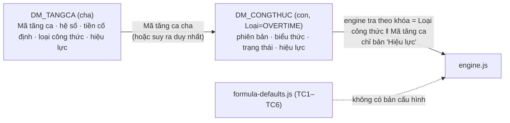

# V10.2 — Danh mục tăng ca Master–Detail + Trình thiết kế công thức

Trạng thái: **bản nháp chờ nghiệm thu** (PR draft, chưa merge). Phạm vi V10.2 chỉ là **tăng ca** (`DM_TANGCA` → `DM_CONGTHUC` loại OVERTIME). Phụ cấp / hỗ trợ chưa mở rộng — chỉ làm sau khi tăng ca được nghiệm thu.

## 1. Quan hệ cha–con

- Dòng ALLOWANCE/SUPPORT vẫn nằm cùng bảng `dm_congthuc`, không bị chạm.
- Engine không đổi kết quả; chỉ thu thêm biến phục vụ kiểm thử (`bienTC`, `coSoTienTC`, `nhanhTienTC`).
- Liên kết cha chỉ gán khi suy ra **duy nhất**; không đoán. Có cột `Mã tăng ca cha` + `Liên kết lúc` (mã đợt, hoàn tác theo đợt, chỉ Admin đổi).

## 2. Giao diện
Danh sách Master (tìm, lọc trạng thái/công thức, kỳ xét) → Form Modal 4 tab: **Thông tin** · **Công thức tính** (danh sách phiên bản, thiết kế trực quan/nâng cao, thư viện biến từ `formula-variables.js`, cùng parser/validator, không `eval`) · **Kiểm thử thực tế** (so sánh hiện tại/thử trên dữ liệu chấm công thật, công Chủ nhật tự lấy, "Chưa có dữ liệu" khi thiếu, TC5 theo tiền cố định, CN1/CN2 theo nhánh engine, lưu ca kiểm thử) · **Lịch sử phiên bản**.
Luồng trạng thái: Nháp → Chờ duyệt → Đã duyệt → Hiệu lực → Ngừng; chỉ Nháp sửa được; kích hoạt có kiểm tra trước (cú pháp, chia 0, công ty, chồng hiệu lực — tự đóng ngày bản cũ, kỳ đã chốt, so sánh). Quyền kiểm lại ở Main (`main/write-policy.js`).
TC6 trong mẫu wizard ≠ TC6 thật: gắn nhãn "[Tham khảo]", không tự sửa.

## 3. Kết quả kiểm thử (ngày 14/10/2026)
| Bộ | Kết quả |
|---|---|
| Unit (`npm test`) | 602/602 đạt (gồm U-OT-01..23 mới) |
| ESLint 9 `--max-warnings 0` | sạch |
| E2E tổng (`run-e2e.js`) | 253 bước PASS, 0 FAIL |
| E2E giao diện V10.2 (`tests/e2e/v102-overtime-shots.js`) | 66/66 đạt, 0 lỗi JS, modal không tràn ở 1366×768 và 1920×1080 |
| Đối chiếu trước/sau (`tools/v102/recon-overtime.js`) | 24 dòng (8 mã × 3 kỳ), **0 chênh lệch** tiền tăng ca và thực lĩnh |

Ảnh Electron thật: `docs/v10_2_screens/1366x768/` và `1920x1080/` (danh sách, modal, thiết kế, kiểm thử, lịch sử, kích hoạt, liên kết). Dữ liệu giả lập.
Hiệu năng: mở modal 36–45 ms; gõ ô biểu thức < 1 ms (chỉ cập nhật phần phân tích).

## 4. Giới hạn / việc còn mở (nói thẳng)
- Mẫu đối chiếu giả lập: **CN1/CN2 cho 0 đồng ở cả hai bản** (dữ liệu mẫu không có công vượt phù hợp) → chưa chứng minh được nhánh CN bằng số tiền khác 0; nhánh này đã có unit test riêng. TC6 có số liệu (5.808.405).
- Chưa chạy trên bảng lương thật (quy định giữ 3 workbook thật ngoài repo). Cần đối chiếu trên dữ liệu thật tại máy người dùng.
- Cần UAT trên Windows/EXE, chưa làm trong V10.2.
- Quyền đọc chưa kiểm ở Main (chỉ quyền ghi); OCR chưa đo bằng bản scan thật; quyết định B/C/E đối chiếu và chính sách KPCĐ vẫn chờ xác nhận.
- Đã sửa trong lúc nghiệm thu: nút chuyển trạng thái (Gửi duyệt/Trả về nháp) không vẽ lại danh sách; `integrity.normalizeDataset` cắt mất giờ của "Ngày lập"; chuyển trạng thái nhiều bước bị gộp lưu rồi Main từ chối (nay dùng `txn`).

## 5. Tệp thay đổi
Mới: `core/payroll/overtime-master.js`, `core/payroll/formula-templates.js`, `ui/overtime-master.js`, `tests/unit/v102-overtime-master.test.js`, `tests/e2e/v102-overtime-shots.js`, `tools/v102/recon-overtime.js`.
Sửa: `app.js`, `engine.js` (chỉ thu biến), `core/payroll/formula-approval.js`, `core/repository.js`, `core/integrity.js`, `main/write-policy.js`, `index.html`, `style.css`, `tests/e2e/run-e2e.js`.
